 

$ cat about.md

I build back-end systems with AI inside them: from models trained on the system's own data to LLM agents with tool calling that take real actions through APIs. Underneath, I care about the engineering that makes AI reliable in production: clean architecture, cloud, DevOps and tests.

	•	🤖 Applied AI: machine learning (data preparation, training, model serialization) and LLM agents with tool calling
	•	💼 Network Analyst at Brasil TecPar
	•	🎓 Software Engineering student at PUC Minas
	•	🧩 Architecture: microservices, event-driven architecture and hexagonal architecture
	•	⚙️ Delivery: Docker, CI/CD with GitHub Actions and Infrastructure as Code
	•	🧪 Quality: Clean Code, SOLID, unit, integration and E2E tests running before anything reaches main
	•	🤝 Open to opportunities in AI Engineering and Back-End

$ kubectl get projects

Project	Description	Stack	Status
delivery-ai-assistant	LLM-powered ordering assistant for delivery-ai: an agent with tool calling that browses the menu, builds orders and tracks deliveries through the platform's APIs	Python · LLM · Tool calling · Docker	building
delivery-ai	Delivery platform with 6 Spring Boot services and ML route intelligence (observation preparation, training and model serialization), plus API Gateway, transactional outbox, idempotent consumers with retry/DLQ and JWT (RS256 + JWKS)	Java 21 · Spring Boot · Machine Learning · RabbitMQ · PostgreSQL · Docker · GitHub Actions	v1
ticket-ops	High-concurrency event ticketing platform: saga, outbox, Redis seat locking and full observability	Go · Kafka · Redis · Kubernetes · AWS Lambda · Terraform	building
finance-control	Personal finance REST API	Java · Spring Boot · PostgreSQL	done

$ ls ~/stack

AI & Machine Learning

Languages & Back-End

Messaging & Data

Cloud, Containers & IaC

CI/CD & Observability

Tools & Environment

Testing & Migrations

$ cat training.log

	•	CS50's Introduction to Artificial Intelligence with Python · Harvard University · 12 projects
	•	AWS DevOps Practices · AWS Skill Builder
	•	Java Foundations · Oracle
<!-- Certifications: descomente quando passar na prova
## `$ ls ~/certifications`

-->

$ git log --stats

<picture>
  <source media="(prefers-color-scheme: dark)" srcset="https://raw.githubusercontent.com/victhor-loiola/victhor-loiola/output/snake-dark.svg"/>
  <source media="(prefers-color-scheme: light)" srcset="https://raw.githubusercontent.com/victhor-loiola/victhor-loiola/output/snake-light.svg"/>
  
</picture>

