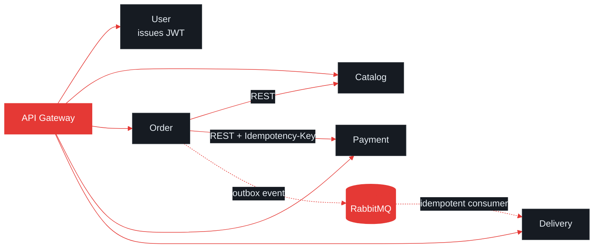
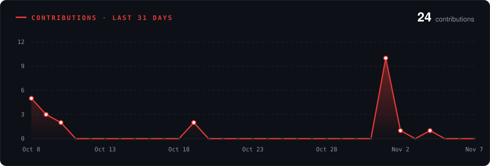

<div align="center">



<a href="https://www.linkedin.com/in/victhor-loiola">
  
</a>

<br/>

<a href="https://www.linkedin.com/in/victhor-loiola"></a>
<a href="mailto:loiola_victhor@hotmail.com"></a>


</div>

<br/>


## 01 · About me

I'm a **Software Engineering student at PUC Minas** building back-end systems with **Java** and **Spring Boot**: REST APIs, PostgreSQL databases with versioned migrations, authentication with Spring Security and communication between services with RabbitMQ. Each project documents its decisions and trade-offs, not just the code.

```java
public class Victhor implements BackEndDeveloper {

    String education  = "B.Sc. Software Engineering @ PUC Minas (2025 – 2029)";
    String currentJob = "Network Technical Support @ Brasil TecPar";

    List<String> stack = List.of("Java 21", "Spring Boot", "Spring Security",
                                 "PostgreSQL", "RabbitMQ", "Docker");

    List<String> languages = List.of("Portuguese", "English (B1)");

    @Override
    public String lookingFor() {
        return "Back-end internship or junior role · Belo Horizonte area";
    }
}
```


## 02 · Featured project

### [delivery-ai](https://github.com/victhor-loiola/delivery-ai)

Delivery platform built with **microservices in Java 21 and Spring Boot**. The customer creates an account, builds an order from a restaurant menu, pays and requests the delivery; an operator takes the delivery to the end. The focus is the **integration between services**.



- **One database per service** — PostgreSQL + Flyway; layers `domain` → `application` → `api` → `infrastructure`
- **Transactional outbox** with publisher confirms, **idempotent consumer**, retries with backoff and **dead-letter queue**
- **Idempotent payments** with `Idempotency-Key` and **optimistic locking** with `@Version`
- **JWT RS256** issued only by the User service and validated by the others through **JWKS**
- **`X-Request-Id`** propagated through every service and RabbitMQ, with metrics on Actuator
- **JUnit 5, Mockito and Testcontainers**, running on **GitHub Actions** for every pull request


## 03 · Projects

| Project | About | Stack | Status |
| :-- | :-- | :-- | :-: |
| [**delivery-ai**](https://github.com/victhor-loiola/delivery-ai) | Delivery platform with microservices: orders, payments and deliveries integrated through REST and RabbitMQ events | Java 21 · Spring Boot · RabbitMQ · PostgreSQL · Docker |  |
| [**finance-control**](https://github.com/victhor-loiola/finance-control) | Personal finance REST API: accounts, categories, income and expenses, balance per account and filtered statements. Each user only accesses their own data | Java 21 · Spring Boot · Spring Security · PostgreSQL · Flyway |  |
| [**task-manager**](https://github.com/victhor-loiola/task-manager) | Terminal task manager in plain Java to practice OOP: encapsulation, enums, collections and exception handling | Java 21 |  |


## 04 · Tech stack

<div align="center">


<br/><br/>


</div>


## 05 · Training

- **Java Foundations** · Oracle
- **AWS DevOps Practices** · AWS Skill Builder

<!-- Certifications: descomente quando passar na prova
[](LINK_DO_CREDLY)
-->


## 06 · GitHub activity

<div align="center">




<picture>
  <source media="(prefers-color-scheme: dark)" srcset="https://raw.githubusercontent.com/victhor-loiola/victhor-loiola/output/snake-dark.svg"/>
  <source media="(prefers-color-scheme: light)" srcset="https://raw.githubusercontent.com/victhor-loiola/victhor-loiola/output/snake-light.svg"/>
  
</picture>

</div>


<div align="center">
  <sub>Thanks for stopping by · Let's build something together</sub>
</div>
