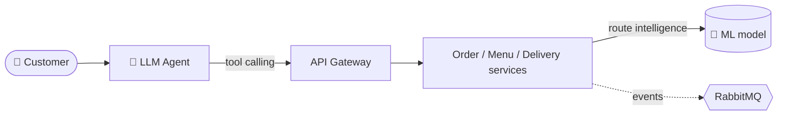

 

---

## `$ cat about.md`

I'm a computing enthusiast focused on the advanced side of Software Engineering: **applied AI, architecture, cloud computing, DevOps and security**. I build **scalable and reliable back-end systems with Java, Python and Go**, and I put **AI to work inside them**: models trained on the system's own data and **LLM agents** that act through real APIs.

- 💼 **Network Analyst** at **Brasil TecPar**
- 🎓 **Software Engineering** student at **PUC Minas**
- 🧠 AI: **machine learning** (observation prep, training, model serialization) and **LLM agents** with **tool calling**
- 🧩 Architecture: **microservices**, **event-driven microservices** and **hexagonal architecture**
- ⚙️ Delivery: **CI/CD**, **Infrastructure as Code**, automated pipelines with **GitHub Actions**
- 🧪 Quality: **Clean Code**, **SOLID**, unit, integration and **E2E tests** running before anything reaches `main`
- 🤝 **Open to opportunities** in **AI Engineering** and **Back-End**
  
---

## `$ ./now-building.sh`

> **[delivery-ai-assistant](https://github.com/victhor-loiola/delivery-ai-assistant)** — an LLM agent that turns a conversation into real actions on the delivery-ai platform.

---

## `$ kubectl get projects`

| Project | Description | Stack | Status |
| :-- | :-- | :-- | :-- |
| [**delivery-ai-assistant**](https://github.com/victhor-loiola/delivery-ai-assistant) | Ordering assistant: LLM agent with tool calling over the delivery-ai APIs | Python · LLM · Tool calling · Docker |  |
| [**delivery-ai**](https://github.com/victhor-loiola/delivery-ai) | Delivery platform with 6 Spring Boot services, **ML route intelligence**, API Gateway, transactional outbox, idempotent consumers with retry/DLQ and JWT (RS256 + JWKS) | Java 21 · Spring Boot · ML · RabbitMQ · PostgreSQL · Docker · GitHub Actions |  |
| [**finance-control**](https://github.com/victhor-loiola/finance-control) | Personal finance REST API | Java · Spring Boot · PostgreSQL |  |

---

## `$ ls ~/stack`

**Languages & Back-End**

**AI & Machine Learning**

**Messaging & Data**

**Cloud, Containers & IaC**

**CI/CD & Observability**

**Tools & Environment**

**Testing & Migrations**

---

## `$ cat training.log`

- [**CS50's Introduction to Artificial Intelligence with Python**](https://cs50.harvard.edu/certificates/2d50af5d-a28d-4c99-a9f1-e556a76b1c6d) · Harvard University · 12 projects
- **AWS DevOps Practices** · AWS Skill Builder
- **Java Foundations** · Oracle

<!-- Certifications: descomente quando passar na prova
## `$ ls ~/certifications`

-->

---

## `$ git log --stats`

<picture>
  <source media="(prefers-color-scheme: dark)" srcset="https://raw.githubusercontent.com/victhor-loiola/victhor-loiola/output/snake-dark.svg"/>
  <source media="(prefers-color-scheme: light)" srcset="https://raw.githubusercontent.com/victhor-loiola/victhor-loiola/output/snake-light.svg"/>
  
</picture>

